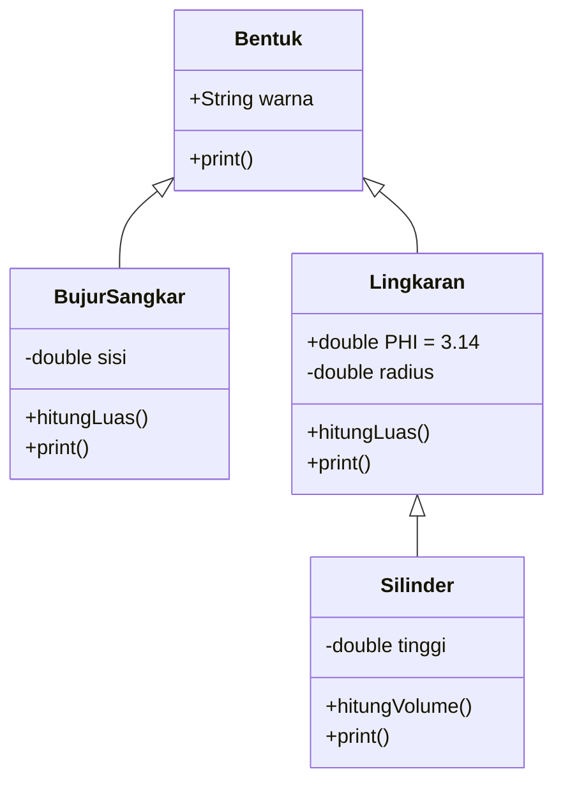
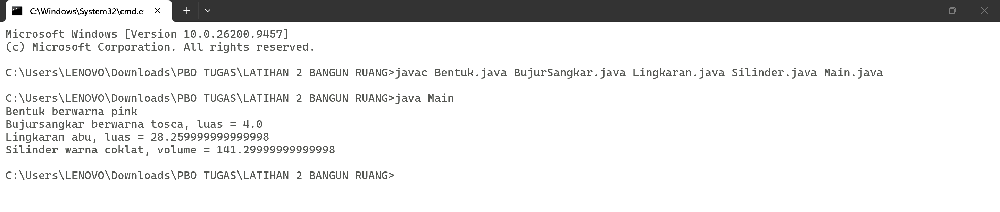

<div align="center">

# 🔷 Inheritance dan Polymorphism 🔷


</div>

---

## ⚙️ Implementasi

### 🧬 1. Pewarisan

Kelas anak memakai kata kunci `extends` untuk mewarisi atribut dan method dari kelas induk. Constructor anak memanggil `super(...)` untuk mengisi atribut milik induk.

```java
public class BujurSangkar extends Bentuk {
    public BujurSangkar(double sisi, String warna) {
        super(warna);          // mengisi atribut warna milik Bentuk
        this.sisi = sisi;
    }
}

public class Silinder extends Lingkaran {
    public double hitungVolume() {
        return hitungLuas() * tinggi;   // memakai method milik Lingkaran
    }
}
```

| Kelas | Mewarisi | Yang diwarisi |
|-------|:--------:|---------------|
| `BujurSangkar` | `Bentuk` | atribut `warna`, method `getWarna()` & `setWarna()` |
| `Lingkaran` | `Bentuk` | atribut `warna`, method `getWarna()` & `setWarna()` |
| `Silinder` | `Lingkaran` | `radius`, `PHI`, `hitungLuas()`, dan `warna` dari `Bentuk` |

### 🎭 2. Polimorfisme

Method `print()` ditulis ulang (*override*) di setiap kelas turunan, sehingga satu nama method menghasilkan keluaran yang berbeda sesuai objeknya.

| Objek | Method yang dipanggil | Keluaran |
|-------|-----------------------|----------|
| `Bentuk` | `print()` milik `Bentuk` | Bentuk berwarna pink |
| `BujurSangkar` | `print()` milik `BujurSangkar` | Bujursangkar berwarna tosca, luas = 4.0 |
| `Lingkaran` | `print()` milik `Lingkaran` | Lingkaran abu, luas = 28.26 |
| `Silinder` | `print()` milik `Silinder` | Silinder warna coklat, volume = 141.3 |

```java
// Bentuk.java
public void print() {
    System.out.println("Bentuk berwarna " + warna);
}

// Silinder.java  (override)
public void print() {
    System.out.println("Silinder warna " + warna + ", volume = " + hitungVolume());
}
```

### 🧩 3. Struktur Kelas


---

## ▶️ Cara Menjalankan

```bash
# Compile
javac Bentuk.java BujurSangkar.java Lingkaran.java Silinder.java Main.java

# Jalankan
java Main
```

## 📸 Hasil Output

<div align="center">



</div>

```text
Bentuk berwarna pink
Bujursangkar berwarna tosca, luas = 4.0
Lingkaran abu, luas = 28.259999999999998
Silinder warna coklat, volume = 141.29999999999998
```

> Angka desimal panjang muncul karena keterbatasan presisi `double`, bukan kesalahan program.

---

## 👤 Identitas

| | |
|:--|:--|
| 👨‍🎓 **Nama** | `Asmaul Husnah` |
| 🔢 **NIM** | `F1d02510106` |
| 🏫 **Kelas** | `B` |
| 📚 **Mata Kuliah** | Pemrograman Berorientasi Objek (PBO) |
